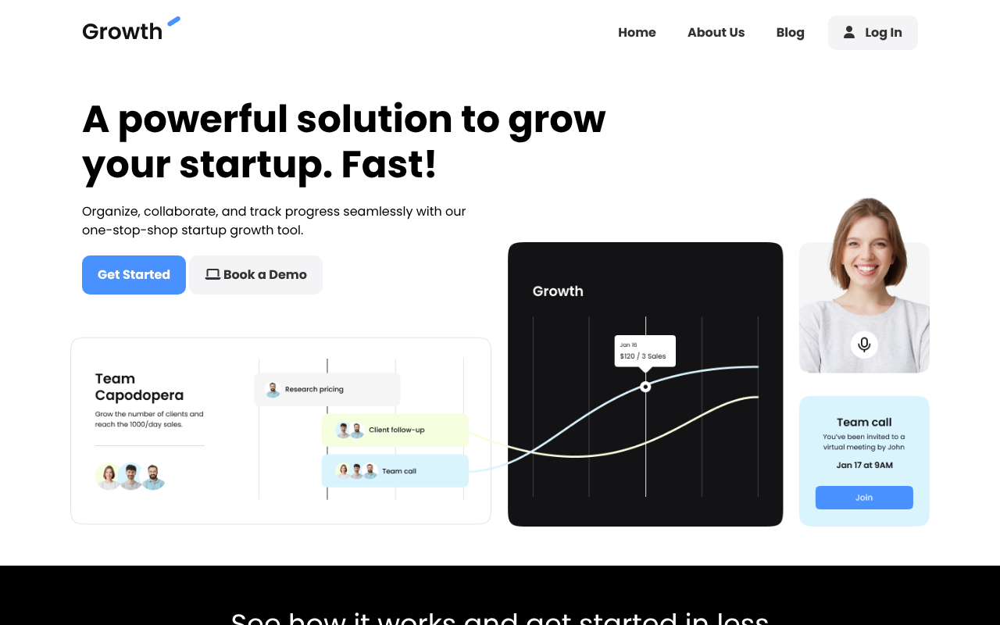
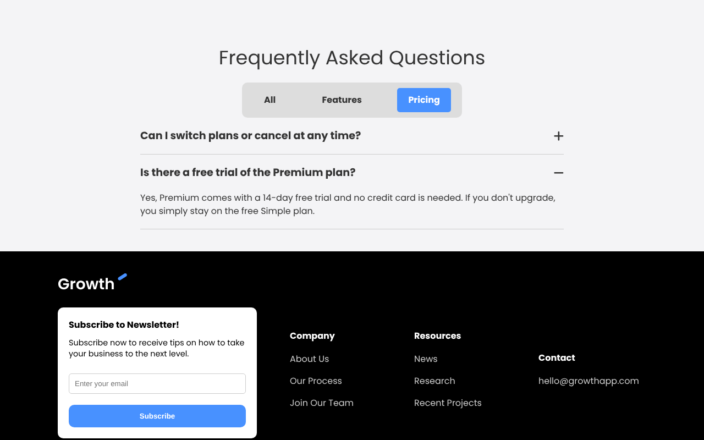
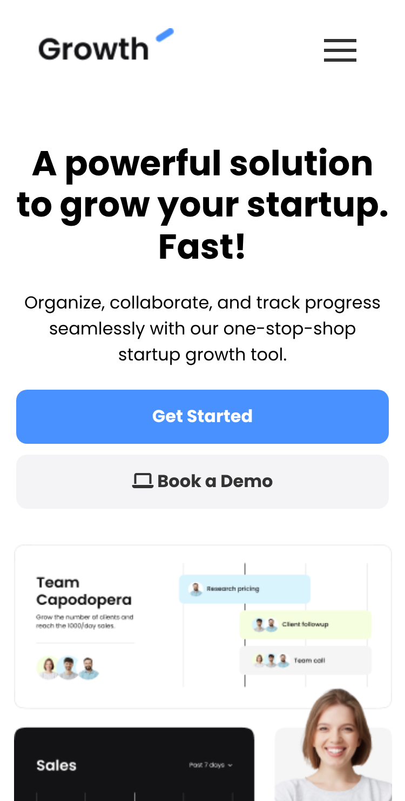
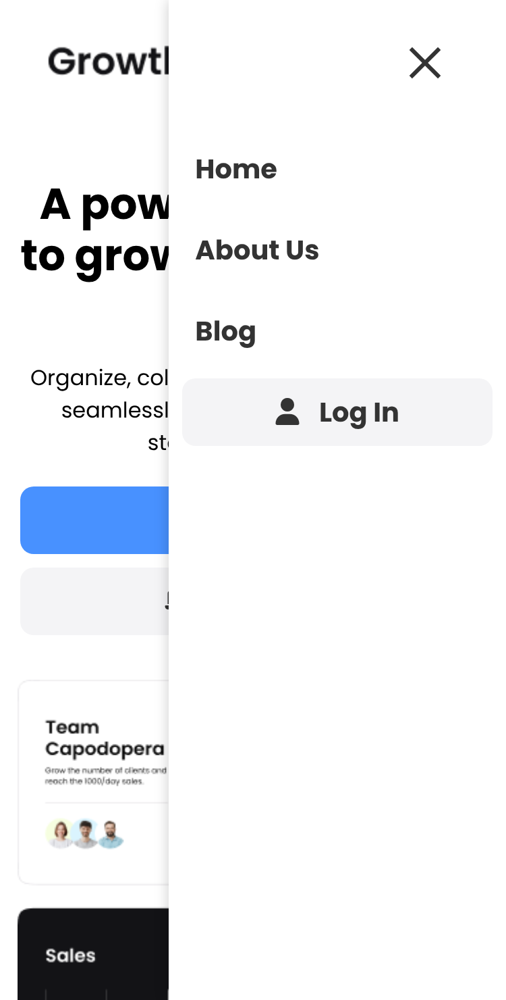

# Growth – SaaS Landing Page

Responsive landing page for a fictional startup-growth SaaS, built with semantic HTML, modern CSS (Grid, Flexbox, custom properties) and vanilla JavaScript. It has no frameworks and no build step.

**Live demo:** https://wonderful-sfogliatella-43b497.netlify.app/



| FAQ with category filter | Mobile | Mobile menu |
| --- | --- | --- |
|  |  |  |

## About

I built the first version of this page while following Brad Traversy's (Traversy Media) HTML & CSS project on YouTube.

Afterwards I went back to the project to review and improve it on my own. I used an AI pair-programmer (Claude) for parts of this work. I reviewed, tested and committed every change myself and can walk through any part of the code.

## What I added and improved

### JavaScript
- **Accessible FAQ accordion:** each question is a real `<button>` inside a heading (the WAI-ARIA accordion pattern), with `aria-expanded`/`aria-controls` and the native `hidden` attribute. It works with the keyboard (Tab, Enter, Space) and opens one answer at a time. It also uses **event delegation**: one listener handles all questions.
- **Working FAQ category filter:** the All / Features / Pricing buttons were only decoration in the original. Now they filter the questions with `data-*` attributes, so adding a question needs no JavaScript changes. A visually hidden `aria-live` region announces the number of results.
- **Mobile menu:** turns into an ✕ when open, and closes on link click, the **Escape** key (focus returns to the button), a click outside the menu, or a resize to desktop. The hidden menu uses `visibility: hidden`, so its links can't receive focus when it's closed.
- **Progressive enhancement:** the FAQ answers are visible without JavaScript. The script collapses them only once it runs.

### HTML and accessibility
- Correct heading hierarchy (`h1` → `h2` per section → `h3`)
- Testimonials marked up as `<figure>`, `<blockquote>` and `<figcaption>`
- Meaningful `alt` text, `aria-label` on icon-only links and buttons, decorative icons hidden with `aria-hidden`
- A labelled newsletter email input, a meta description and a descriptive page title
- Visible `:focus-visible` styles for keyboard users and `prefers-reduced-motion` support

### CSS
- **I removed `overflow-x: hidden` from `body`.** It was hiding a real overflow bug, so I fixed the cause instead (a fixed `width: 700px` heading became `max-width`).
- Replaced fixed `height` with `min-height`, so content can't overflow its section.
- Added `position: relative` to the hamburger button, because its `z-index` had no effect without it.

### Content
- Replaced the placeholder (lorem ipsum) FAQ answers with real copy and added pricing questions
- Fixed typos and inconsistent spelling

## Built with

- HTML5
- CSS3 (Grid, Flexbox, custom properties, media queries)
- Vanilla JavaScript
- Font Awesome and Google Fonts (Poppins)
- Netlify (continuous deployment from `main`)

## Run locally

There are no dependencies to install:

```bash
git clone https://github.com/koutsavlis/saas-landing-page.git
cd saas-landing-page
```

Then open `index.html` in your browser, or use the **Live Server** extension in VS Code.
